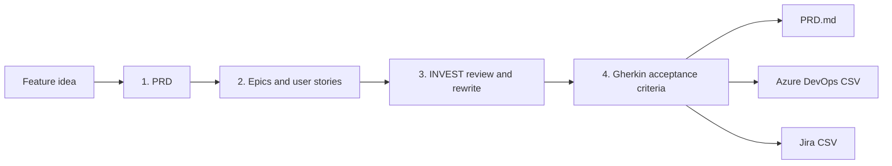

# AI PRD & User Story Generator

[](https://github.com/dperezandre/ai-prd-story-generator/actions)

**Turn a one-line feature idea into a PRD, INVEST-reviewed user stories and Gherkin acceptance criteria, ready to import into Azure DevOps or Jira.**

🇧🇷 [Leia em português](README.pt-BR.md)

## The problem

Writing product specifications is slow and uneven. A Product Owner spends hours turning a loose idea into a PRD, splitting it into stories and writing acceptance criteria, and the quality depends on the day: stories end up too big, vague ("fast", "easy") or impossible to test, and the team finds out in the middle of the sprint.

Generic AI chat makes this faster but not better. It happily invents metrics, writes stories that describe implementation instead of value, and does not check its own work against any standard.

## The solution

A pipeline that works the way a careful PO does: draft, then **review against a rubric**, then write acceptance criteria.



- **PRD** with problem, personas, goals, metrics, scope in/out, requirements, risks, **assumptions and open questions**. The prompts instruct the model to label anything the idea did not say as an assumption.
- **User stories** with MoSCoW priority and points, each carrying a reference to the PRD requirement it came from (the reference is text written by the model, not verified by code).
- **INVEST reviewer**: an adversarial PO scores every story 0-2 on each criterion and rewrites the weak ones.
- **Gherkin** scenarios in business language; the prompt asks for a success, an alternative and an error path per story.
- **Exports** for Azure DevOps and Jira, plus the PRD in Markdown. See the [import guide](docs/import-guide.md).
- **Bilingual**: output in English or Brazilian Portuguese, with prompts written natively in each.

## Before and after (INVEST review)

From the bundled [referral program example](examples/referral.en.json):

| | Story | Points | INVEST (0-12) |
|---|---|---|---|
| Draft | *As a friend, I want a fast and nice landing experience, so that people convert.* | 13 | 5 |
| After review | *As a referred friend, I want to see my discount when I arrive through a referral link and again at checkout, so that I know the offer is real before I buy.* | 3 | 12 |

The reviewer's note: *"'Fast' and 'nice' cannot be verified and the size does not fit a sprint; rewritten around the discount the friend actually needs to see."*

## Quick start

```bash
git clone https://github.com/dperezandre/ai-prd-story-generator.git
cd ai-prd-story-generator
pip install -r requirements.txt
streamlit run app.py
```

Demo mode is on by default: it replays two pre-written examples with **no API key and no calls to any AI provider**, so you can explore every tab and download the CSVs straight away.

To use your own ideas, turn demo mode off in the sidebar, choose a provider and paste your API key. The key is kept in memory for that Streamlit session only; it is never written to disk or logged by this app.

| Provider | Notes |
|---|---|
| Google Gemini | Has had a free tier; check Google's current limits |
| Groq | Has had a free tier with open models; check current limits |
| Anthropic Claude | Paid, pay per use |
| OpenAI | Paid, pay per use |

Free tiers and model names change often. Check each provider's page before relying on them.

## Product decisions

- **Why an INVEST reviewer and not one big prompt?** A single prompt grades its own work generously. A separate adversarial step with an objective rubric catches oversized and untestable stories before they reach a sprint.
- **Why Gherkin?** It forces acceptance criteria into observable behaviour that business and engineering can both read, and it can be automated later.
- **Why assumptions and open questions in the PRD?** A PRD that hides what it guessed is worse than no PRD. The prompts forbid inventing numeric targets.
- **Why CSV and not the Azure DevOps or Jira APIs?** CSV import needs no tokens or permissions beyond what a PO already has, and keeps the tool safe to demo. Direct integration is on the roadmap.
- **Why is the clarifying interview not in v1?** It is valuable, but the pipeline is already useful without it and the scope stays small enough to ship and test.

More detail: [prompt design notes](docs/prompt-design.md).

## Project structure

```
app.py              Streamlit UI (only UI)
src/pipeline.py     the four steps and the JSON retry
src/providers.py    Gemini, Groq, Claude and OpenAI behind one interface
src/models.py       validated PRD, Story, Review models
src/exporters.py    Markdown, Azure DevOps CSV, Jira CSV
src/demo.py         demo mode
scripts/            regenerate the examples with a real provider
prompts/en|pt-BR/   the four system prompts per language
examples/           two complete cases in both languages
docs/               import guide, prompt design notes
tests/              pytest suite (no network, no cost)
```

Run the tests with `python -m pytest`.

## Limitations

- The bundled examples were **written and curated by hand** to show the intended output; they are not a transcript of a model run. Use `python -m scripts.generate_examples` to regenerate them with a real provider.
- The pipeline is tested with a fake provider and mocked HTTP responses. Quality of output with a real model depends on the model you choose.
- The CSV formats follow the official documentation but have not yet been verified against a live Azure DevOps organization or Jira site.
- A single idea per run; no history is kept.

## Roadmap

- Clarifying interview step before the PRD.
- Direct creation of work items through the Azure DevOps and Jira APIs.
- Version history and comparison of runs.

## License

MIT, see [LICENSE](LICENSE).
