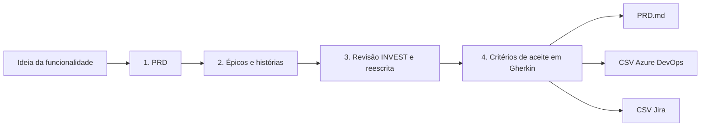

# Gerador de PRD e Histórias de Usuário com IA

[](https://github.com/YOUR_GITHUB_USER/ai-prd-story-generator/actions)

**Transforme uma ideia de funcionalidade em um PRD, histórias de usuário revisadas pelo INVEST e critérios de aceite em Gherkin, prontos para importar no Azure DevOps ou no Jira.**

🇺🇸 [Read in English](README.md)

## O problema

Escrever especificações de produto é lento e irregular. O Product Owner gasta horas transformando uma ideia solta em PRD, quebrando em histórias e escrevendo critérios de aceite, e a qualidade varia conforme o dia: as histórias saem grandes demais, vagas ("rápido", "fácil") ou impossíveis de testar, e o time só descobre isso no meio da sprint.

O chat de IA genérico acelera o trabalho, mas não melhora a qualidade. Ele inventa métricas com facilidade, escreve histórias que descrevem implementação em vez de valor e não confere o próprio resultado contra nenhum padrão.

## A solução

Um pipeline que trabalha como um PO cuidadoso: primeiro o rascunho, depois a **revisão contra uma régua**, e só então os critérios de aceite.



- **PRD** com problema, personas, objetivos, métricas, escopo dentro e fora, requisitos, riscos, **premissas e perguntas em aberto**. Os prompts instruem o modelo a marcar como premissa tudo o que a ideia não disse.
- **Histórias de usuário** com prioridade MoSCoW e pontos, cada uma com a referência ao requisito do PRD de onde veio (a referência é texto escrito pelo modelo, não verificado pelo código).
- **Revisor INVEST**: um PO adversarial dá nota de 0 a 2 em cada critério de cada história e reescreve as fracas.
- **Gherkin** em linguagem de negócio; o prompt pede um caminho de sucesso, um alternativo e um de erro por história.
- **Exportações** para Azure DevOps e Jira, além do PRD em Markdown. Veja o [guia de importação](docs/import-guide.pt-BR.md).
- **Bilíngue**: saída em português do Brasil ou em inglês, com prompts escritos nativamente em cada idioma.

## Antes e depois (revisão INVEST)

Do [exemplo do programa de indicação](examples/referral.pt-BR.json) que acompanha o projeto:

| | História | Pontos | INVEST (0-12) |
|---|---|---|---|
| Rascunho | *Como amigo, quero uma experiência de chegada rápida e bonita, para que as pessoas convertam.* | 13 | 5 |
| Após a revisão | *Como amigo indicado, quero ver meu desconto ao chegar por um link de indicação e de novo no checkout, para que saiba que a oferta é real antes de comprar.* | 3 | 12 |

A nota do revisor: *"'Rápida' e 'bonita' não são verificáveis e o tamanho não cabe em uma sprint; reescrita em torno do desconto que o amigo precisa ver."*

## Como rodar

```bash
git clone https://github.com/YOUR_GITHUB_USER/ai-prd-story-generator.git
cd ai-prd-story-generator
pip install -r requirements.txt
streamlit run app.py
```

O modo demo vem ligado por padrão: ele reproduz dois exemplos pré-escritos **sem chave de API e sem chamar nenhum provedor de IA**, então você explora todas as abas e baixa os CSVs na hora.

Para usar suas próprias ideias, desligue o modo demo na barra lateral, escolha um provedor e cole a sua chave de API. A chave fica na memória apenas durante a sessão do Streamlit; este app nunca a grava em disco nem a registra em log.

| Provedor | Observações |
|---|---|
| Google Gemini | Já teve plano gratuito; confira os limites atuais do Google |
| Groq | Já teve plano gratuito com modelos abertos; confira os limites atuais |
| Anthropic Claude | Pago, por uso |
| OpenAI | Pago, por uso |

Planos gratuitos e nomes de modelos mudam com frequência. Confira a página de cada provedor antes de depender deles.

## Decisões de produto

- **Por que um revisor INVEST e não um prompt único?** Um prompt único avalia o próprio trabalho com generosidade. Uma etapa separada, adversarial e com régua objetiva, pega histórias grandes e não testáveis antes que cheguem a uma sprint.
- **Por que Gherkin?** Ele obriga os critérios de aceite a virar comportamento observável, legível por negócio e engenharia, e pode ser automatizado depois.
- **Por que premissas e perguntas em aberto no PRD?** Um PRD que esconde o que foi chutado é pior que nenhum PRD. Os prompts proíbem inventar metas numéricas.
- **Por que CSV e não as APIs do Azure DevOps ou do Jira?** A importação por CSV não exige tokens nem permissões além das que um PO já tem, e deixa a ferramenta segura para demonstrar. A integração direta está no roadmap.
- **Por que a entrevista de esclarecimento não está na v1?** Ela é valiosa, mas o pipeline já é útil sem ela, e o escopo fica pequeno o bastante para entregar e testar.

Mais detalhes: [notas de design dos prompts](docs/prompt-design.md) (em inglês).

## Estrutura do projeto

```
app.py              interface Streamlit (só interface)
src/pipeline.py     as quatro etapas e a nova tentativa de JSON
src/providers.py    Gemini, Groq, Claude e OpenAI atrás de uma interface
src/models.py       modelos validados de PRD, História e Revisão
src/exporters.py    Markdown, CSV Azure DevOps, CSV Jira
src/demo.py         modo demo
scripts/            regenera os exemplos com um provedor real
prompts/en|pt-BR/   os quatro prompts de sistema por idioma
examples/           dois casos completos nos dois idiomas
docs/               guia de importação, notas de design
tests/              suíte pytest (sem rede, sem custo)
```

Rode os testes com `python -m pytest`.

## Limitações

- Os exemplos incluídos foram **escritos e curados à mão** para mostrar a saída pretendida; não são a transcrição de uma execução de modelo. Use `python -m scripts.generate_examples` para regenerá-los com um provedor real.
- O pipeline é testado com um provedor falso e respostas HTTP simuladas. A qualidade da saída com um modelo real depende do modelo escolhido.
- Os formatos de CSV seguem a documentação oficial, mas ainda não foram verificados em uma organização real do Azure DevOps nem em um site Jira.
- Uma ideia por execução; não há histórico.

## Roadmap

- Etapa de entrevista de esclarecimento antes do PRD.
- Criação direta de work items pelas APIs do Azure DevOps e do Jira.
- Histórico de versões e comparação entre execuções.

## Licença

MIT, veja [LICENSE](LICENSE).
